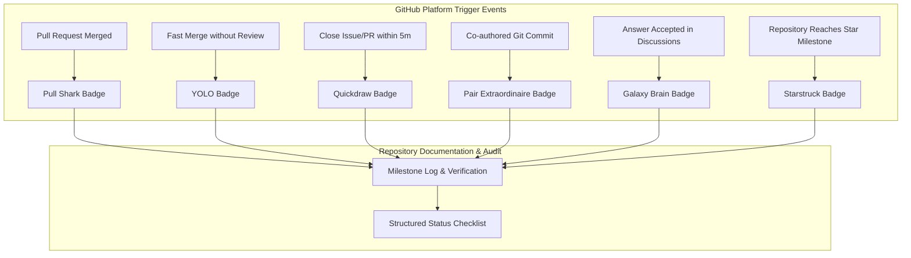

<p align="center">
  
</p>

# ◈ GitHub Achievement Hunt

[](https://github.com/ISBANDURAHUMAN-R/ACHIEVEMENT/actions/workflows/ci.yml)

## ◆ About the Project
This repository tracks and documents the unlock status, contribution criteria, and milestone progress for official GitHub profile badges and achievements. It serves as an open reference and personal log for specific GitHub platform activities.

## ❖ Key Features
- Structured status checklist tracking GitHub badges (Pull Shark, Quickdraw, YOLO, Pair Extraordinaire, Galaxy Brain, Starstruck).
- Historical achievement log documenting verified unlock milestones.
- Reference documentation detailing repository contribution workflows for badge triggers.

## ◆ System Architecture

git clone https://github.com/ISBANDURAHUMAN-R/ACHIEVEMENT.git
cd ACHIEVEMENT
## ⬢ Technologies Used
- Markdown
- Git

## § Requirements
- Git client
- Active GitHub account

## ▲ Installation & Execution
```bash
# Clone the repository
git clone https://github.com/ISBANDURAHUMAN-R/ACHIEVEMENT.git
```

## ※ Developer
Developer: ISBANDU RAHUMAN R  
GitHub: https://github.com/ISBANDURAHUMAN-R
